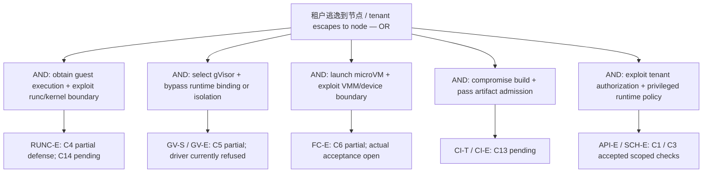
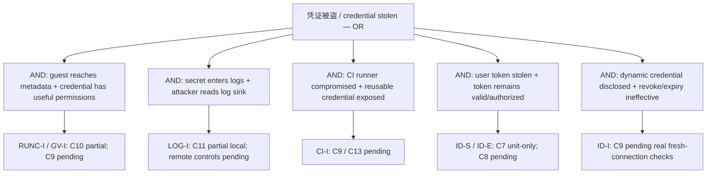

# Warden threat model

Snapshot: 2026-10-25, BASE `f127289b159a69b89045b16a3fcee0cd7562ac8d`.
This is design analysis, not a penetration test
or actual cloud/runtime validation. Only Tasks1/2 are accepted in the current
[status](STATUS.md); other tasks remain OPEN. The original Task6 actual chain
[failed on public-record mode 0664](evidence/task-6/controller-material-actual-blocker-20261025.md)
and is closed without retry. This model grants no runtime or resource authority.

## Boundary and assumptions

Untrusted tenant requests cross the HTTP authentication/authorization boundary
into PostgreSQL run and audit storage. A scheduler claims stored work, rechecks
tenant policy and crosses a durable node gate into a runtime. Guest processes,
their output, images and attack fixtures are untrusted. Node administration,
database administration, issuer configuration, signing identities and CI operators
are separate trust domains; compromise of these authorities remains material.
Production [main](../controlplane/cmd/warden-api/main.go) still supplies a nil
verifier and denies requests. Test identities in accepted API/runtime evidence
do not establish production identity integration.

The intended sandbox defaults are network none, read-only rootfs,
no_new_privileges, UID65534, CPU1, memory512MiB, pids128 and timeout300s.
Explicit trusted tenant policy may authorize bounded changes. Attack execution is
restricted to dedicated warden-lab project/accounts; this task executes none.
Platform cloud identity must use OIDC/federation without long-lived cloud client
credentials; Vault TTL<=1h and max_ttl<=4h are requirements, not deployed facts.
All response actions require dry-run support; destructive actions require a
second identity. See [acceptance requirements](ACCEPTANCE.md).

STRIDE here means spoofing (S), tampering (T), repudiation (R), information
disclosure (I), denial of service (D), and elevation of privilege (E), following
[Microsoft's definitions](https://learn.microsoft.com/en-us/azure/security/develop/threat-modeling-tool-threats).
These are scenarios and proposed mitigations, not claims that every risk is closed.

## Controls and evidence states

**Accepted** means accepted implementation within the cited Task1/2 evidence scope.
**Partial** means local code/unit/fixture evidence or a narrower accepted behavior;
the full control remains open. **Pending** means the required control is not
implemented/validated; its linked ledger is a gap record, never a test result.

### C1 Tenant API boundary

Accepted Task1: verified-tenant filtering, strict request schema, idempotency and
server-owned policy authorization. Evidence: [22 real PostgreSQL tests and limits](evidence/task-1/README.md),
[API tests](../controlplane/internal/api/api_test.go), including
`TestCrossTenantReadDenied`. Production OIDC, distributed rate limits and TLS
deployment are pending; nil production authentication fails closed.

### C2 Audit integrity

Accepted Task1: run/audit transactions, append-only triggers and hash-chain
verification. [Tests](../controlplane/internal/audit/audit_test.go), including
`TestAuditChainDetectsTamper`, and [real evidence](evidence/task-1/README.md).
Database superusers can bypass triggers; external immutable anchoring and remote
pipeline retention are pending. A local chain alone does not prove authorship.

### C3 Scheduler fencing

Accepted Task2: durable claims, stored-tenant reauthorization, node binding,
bounded workers, recovery by Reap and explicit ambiguous/lost outcomes.
[Tests](../controlplane/internal/scheduler/scheduler_test.go) include
`TestConcurrentWorkersExecuteOnce`, `TestPolicyAndMissingDriverFailClosed`,
`TestAmbiguousStartRemainsPendingAcrossRecovery`, and
`TestTerminalAuditFailureRollsBackLogsAndResult`.
[Real HTTP/PG/runc evidence](evidence/task-2/api-runtime/live/README.md) covers a
fixed lab scenario, not fleet recovery or all remote creation races.

### C4 Runc isolation

Accepted Task2: seven real conformance behaviors for pids, read-only root,
network none, nonroot, timeout cleanup, OOM and seccomp mount/ptrace rejection.
[Real results](evidence/task-2/lab-live/README.md), [suite](../runtimes/conformance/suite.go)
and [driver](../runtimes/runc/runc.go). This is not proof against every kernel
escape or the Task5 corpus: its [42-cell matrix](evidence/isolation-matrix.md)
is entirely unevaluated. Image vulnerability and admission gates remain pending.

### C5 GVisor binding

Partial Task3: durable backend identity binding and mismatch refusal, with
[test names](../runtimes/gvisor/binding_test.go) and [explicit limits](gvisor-backend-binding.md).
Kubernetes/runsc driver, current identity checks at each operation, conformance,
guest cleanup and startup measurements remain unaccepted. Operator configuration
currently refuses gvisor; a binding digest is not applied-policy attestation.

### C6 Firecracker boundary

Partial Task4: local guest/driver/protocol/diagnostic controls and finite tests;
[frozen diagnostic results](evidence/task-4/round-5-b/0da497136069bf045912f257f7c6d26c962f9d34/README.md)
report 59 PASS and 4 live SKIP without running a VM. Real guest/conformance,
snapshot and capacity acceptance remain OPEN in [status](STATUS.md).
Original scene/Q5GB and node-retirement uncertainty remain; no new boot is authorized.

### C7 Token verification

Partial Task6: strict issuer/audience/time/signature checks and bounded JWKS
rotation/refresh, [unit test names](../controlplane/internal/authn/verifier_test.go),
including `TestVerify_RejectsWrongAudience`, `TestVerify_JWKSRotation` and
`TestVerify_UnknownKidPressureIsBounded`.
[Accepted unit-only review](evidence/task-6/review-crypto-substage.md) explicitly
excludes real Entra, tenant mapping, SCIM, SQL/reopen and main composition.

### C8 Identity lifecycle and elevation

Pending Tasks6/9: persistent active issuer/subject-to-tenant membership, SCIM
deactivation <=60s, self-approval rejection, grants <=2h and binding removal.
Required test names and evidence are in [acceptance](ACCEPTANCE.md); they are not
present results. Token cryptography does not establish membership or revocation.

### C9 Workload and secret lifetime

Pending Tasks7/8: least-privilege workload federation, sandbox service account
without bindings, actual access tokens <=1h, dynamic DB expiry/revocation and
complete credential inventory. [Task7 rulings](evidence/task-7/controller-proposal-rulings.md)
and [Task8 rulings](evidence/task-8/controller-proposal-rulings.md) are proposals/gap
analysis, not deployed controls. Vault lease expiry alone does not establish
already-issued access-token expiry; provider storage keys must be separately disclosed.

### C10 Network and metadata policy

Partial Task2 default network-none evidence is in [real conformance](evidence/task-2/lab-live/README.md).
Pending Tasks7/10: metadata IP and hostname denial, enforced domain allowlist,
DNS exfiltration detection with positive/negative examples and real lab results.
See [required behaviors](ACCEPTANCE.md) and [unevaluated matrix](evidence/isolation-matrix.md).
API domain validation alone is not network enforcement.

### C11 Log transport and access

Partial Task2: tenant-filtered run logs, bounded snapshots and honest lost/truncated
metadata, [scheduler tests](../controlplane/internal/scheduler/scheduler_test.go)
and [real API/log result](evidence/task-2/api-runtime/live/README.md).
Pending Task11: authenticated source binding, normalized six-source events,
durable buffers, backpressure/loss counters and alerting; see [acceptance](ACCEPTANCE.md).

### C12 Detection and response

Pending Tasks12–14: >=30 rules with positive/negative cases, real query execution,
ATT&CK coverage, detection latency and measured response. The seven-day false-positive
window on the host detector is measured ([evidence](evidence/task-13/seven-day-20261116/README.md)).
Response requires persistent idempotency, dry-run and second-identity approval
for destructive actions. [Evidence destinations and gaps](evidence/README.md#pending-integrations)
and [required tests](ACCEPTANCE.md) remain open; no operational efficacy is claimed.

### C13 CI and artifact admission

Pending Task15: keyless signing bound to the approved workflow identity,
provenance/SBOM verification, unsigned rejection and vulnerability gates.
The [acceptance ledger](ACCEPTANCE.md) specifies future Kyverno and real build
evidence. Digest-only references in accepted Task1/2 code do not prove trustworthy
build origin. No CI workflow or admission deployment is claimed here.

### C14 Vulnerability operations

Partial: [Task1 historical dependency scan](evidence/task-1/vuln-after.log) is a
point-in-time result. Pending Task16: daily sourced feeds, KEV/EPSS prioritization,
7/30/90-day SLA and actual remediation metrics, tracked in [acceptance](ACCEPTANCE.md).
Historical absence of reported vulnerabilities is not continuous monitoring.

## STRIDE register

Each row links its control and a real local test/evidence/gap file. A gap link
records absence; it does not satisfy the pending test or implementation.

| ID | Component / STRIDE | Threat scenario | Control and present state | Direct test or evidence |
|---|---|---|---|---|
| API-S | API / S | Forged bearer or tenant header impersonates another tenant | [C1](#c1-tenant-api-boundary) accepted; [C7](#c7-token-verification) partial | [API boundary tests](../controlplane/internal/api/api_test.go) |
| API-T | API / T | Caller changes resource limits or network privileges | [C1](#c1-tenant-api-boundary) accepted trusted-policy checks | [Task1 policy RED/GREEN](evidence/task-1/README.md) |
| API-R | API / R | Caller denies submission or audit insertion fails silently | [C2](#c2-audit-integrity) accepted local transaction/chain | [Audit tests](../controlplane/internal/audit/audit_test.go) |
| API-I | API / I | Guessed RunID exposes another tenant's status/logs | [C1](#c1-tenant-api-boundary) accepted tenant filtering | [Cross-tenant real checks](evidence/task-2/api-runtime/live/README.md) |
| API-D | API / D | Request flood exhausts API/database capacity | [C1](#c1-tenant-api-boundary) partial size/time bounds; rate quotas pending | [HTTP server time/header bounds](../controlplane/cmd/warden-api/main.go) |
| API-E | API / E | Body or stale retry expands tenant privileges | [C1](#c1-tenant-api-boundary) accepted reauthorization | [Task1 policy revocation evidence](evidence/task-1/README.md) |
| SCH-S | Scheduler / S | Replacement node is accepted as old authority | [C3](#c3-scheduler-fencing) accepted binding | [TestRecoveryCannotMoveRuntimeNodes](../controlplane/internal/scheduler/scheduler_test.go) |
| SCH-T | Scheduler / T | Worker executes changed tenant/spec after queueing | [C3](#c3-scheduler-fencing) accepted stored-spec checks | [TestActiveGuestDoesNotHoldAuditLockAndUsesStoredSpec](../controlplane/internal/scheduler/scheduler_test.go) |
| SCH-R | Scheduler / R | Completion omits audit or hides uncertain launch | [C3](#c3-scheduler-fencing) accepted atomic/explicit outcomes | [TestTerminalAuditFailureRollsBackLogsAndResult](../controlplane/internal/scheduler/scheduler_test.go) |
| SCH-I | Scheduler / I | Guest output leaks across run ownership | [C11](#c11-log-transport-and-access) partial end-to-end log boundary | [Real tenant-B/log checks](evidence/task-2/api-runtime/live/README.md) |
| SCH-D | Scheduler / D | Duplicate claims or stuck workers consume capacity | [C3](#c3-scheduler-fencing) accepted bounded workers | [TestWorkerLifecycleBoundedConcurrencyAndShutdown](../controlplane/internal/scheduler/scheduler_test.go) |
| SCH-E | Scheduler / E | Revoked policy or stale worker launches work | [C3](#c3-scheduler-fencing) accepted reauth/fencing | [TestLostSessionBeforeLaunchCannotCreateAfterRecovery](../controlplane/internal/scheduler/scheduler_test.go) |
| RUNC-S | runc / S | Guest impersonates another run through shared runtime state | [C3](#c3-scheduler-fencing) accepted lab authority isolation | [API/runtime and retirement proof](evidence/task-2/api-runtime/live/README.md) |
| RUNC-T | runc / T | Guest mounts/writes protected root or changes processes | [C4](#c4-runc-isolation) accepted scoped conformance | [Read-only/seccomp real results](evidence/task-2/lab-live/README.md) |
| RUNC-R | runc / R | Guest failure is reported as clean completion | [C3](#c3-scheduler-fencing) accepted result/cleanup handling | [Real nonzero/timeout results](evidence/task-2/api-runtime/live/README.md) |
| RUNC-I | runc / I | Guest reaches metadata or another tenant's resources | [C4](#c4-runc-isolation) partial; [C10](#c10-network-and-metadata-policy) pending broader corpus | [Task5 matrix still unevaluated](evidence/isolation-matrix.md) |
| RUNC-D | runc / D | Fork, OOM or lingering children exhaust node | [C4](#c4-runc-isolation) accepted finite caps/cleanup | [Seven real guest results](evidence/task-2/lab-live/README.md) |
| RUNC-E | runc / E | Guest exploits kernel/runtime to escape to node | [C4](#c4-runc-isolation) partial defense; [C14](#c14-vulnerability-operations) pending ongoing repair | [Actual corpus gaps](evidence/isolation-matrix.md) |
| GV-S | gVisor / S | Cluster/node replacement adopts old runtime authority | [C5](#c5-gvisor-binding) partial binding only | [TestBackendReplacementRejectedBeforeRuntimeOperations](../runtimes/gvisor/binding_test.go) |
| GV-T | gVisor / T | Node ignores or replaces reviewed runsc policy | [C5](#c5-gvisor-binding) partial digest; applied policy pending | [Binding limits](gvisor-backend-binding.md) |
| GV-R | gVisor / R | Lost Job acknowledgement is treated as absent/clean | [C5](#c5-gvisor-binding) partial ambiguity preservation; driver pending | [TestBoundGatePreservesAmbiguityAcrossReopen](../runtimes/gvisor/binding_test.go) |
| GV-I | gVisor / I | Guest reads host/metadata via missing network boundary | [C5](#c5-gvisor-binding), [C10](#c10-network-and-metadata-policy) pending actual integration | [Unevaluated gVisor cells](evidence/isolation-matrix.md) |
| GV-D | gVisor / D | Guest resources or orphan Jobs exhaust node | [C5](#c5-gvisor-binding) partial; live bounds/cleanup pending | [Required Task3 conformance](ACCEPTANCE.md) |
| GV-E | gVisor / E | Incorrect RuntimeClass or runtime flaw enables escape | [C5](#c5-gvisor-binding) partial; [C13](#c13-ci-and-artifact-admission) pending | [Current driver/config limits](gvisor-backend-binding.md) |
| FC-S | Firecracker / S | Wrong VM/session is associated with a RunID | [C6](#c6-firecracker-boundary) partial local binding | [Identity test file](../runtimes/firecracker/identity_test.go) |
| FC-T | Firecracker / T | Mutable rootfs/snapshot input changes guest execution | [C6](#c6-firecracker-boundary) partial local validation | [Snapshot test file](../runtimes/firecracker/snapshot_test.go) |
| FC-R | Firecracker / R | Failed boot or incomplete cleanup is called success | [C6](#c6-firecracker-boundary) partial phase diagnostics | [Frozen diagnostic report with live SKIP](evidence/task-4/round-5-b/0da497136069bf045912f257f7c6d26c962f9d34/README.md) |
| FC-I | Firecracker / I | Guest accesses host files or leaks diagnostic secrets | [C6](#c6-firecracker-boundary) partial local protocol/output guards | [Public-output boundaries](evidence/task-4/round-5-b/0da497136069bf045912f257f7c6d26c962f9d34/README.md) |
| FC-D | Firecracker / D | VM/cgroup leaks or snapshot pressure exhaust node | [C6](#c6-firecracker-boundary) partial; capacity/live retirement pending | [Task4 current limits](STATUS.md) |
| FC-E | Firecracker / E | Guest crosses VMM/jailer/device boundary to node | [C6](#c6-firecracker-boundary) partial; actual escape corpus untested | [Firecracker matrix gaps](evidence/isolation-matrix.md) |
| ID-S | Identity / S | Forged or wrong-audience token authenticates attacker | [C7](#c7-token-verification) unit-only | [TestVerify_RejectsWrongAudience](../controlplane/internal/authn/verifier_test.go) |
| ID-T | Identity / T | Malicious JWKS or token-directed key replaces trust | [C7](#c7-token-verification) unit-only strict trust boundary | [TestVerify_JWKSRejectsUntrustedMaterial](../controlplane/internal/authn/verifier_test.go) |
| ID-R | Identity / R | Grant/revoke action has no accountable record | [C8](#c8-identity-lifecycle-and-elevation) pending audited lifecycle | [Tasks6/9 required evidence](ACCEPTANCE.md) |
| ID-I | Identity / I | Leaked cloud/DB credential remains usable | [C9](#c9-workload-and-secret-lifetime) pending actual expiry/revoke | [Task8 exact limits](evidence/task-8/controller-proposal-rulings.md) |
| ID-D | Identity / D | Unknown kid flood drives unbounded key fetch/waiters | [C7](#c7-token-verification) unit-only bounded refresh | [TestVerify_UnknownKidPressureIsBounded](../controlplane/internal/authn/verifier_test.go) |
| ID-E | Identity / E | Deactivated user or self-approved grant retains access | [C8](#c8-identity-lifecycle-and-elevation) pending; [C9](#c9-workload-and-secret-lifetime) pending | [Lifecycle/second-identity acceptance gaps](ACCEPTANCE.md) |
| LOG-S | Log pipeline / S | Forged source/tenant labels poison detection | [C11](#c11-log-transport-and-access) pending authenticated collection | [Task11 required source goldens](ACCEPTANCE.md) |
| LOG-T | Log pipeline / T | Collector/operator alters or drops security events | [C2](#c2-audit-integrity) local only; [C11](#c11-log-transport-and-access) pending remote integrity | [Audit evidence and superuser limit](evidence/task-1/README.md) |
| LOG-R | Log pipeline / R | Missing records prevent action attribution | [C11](#c11-log-transport-and-access) pending durable remote retention | [Task11 backpressure requirements](ACCEPTANCE.md) |
| LOG-I | Log pipeline / I | Logs disclose secrets or another tenant's output | [C11](#c11-log-transport-and-access) partial local access; remote redaction/ACL pending | [Real local log boundary](evidence/task-2/api-runtime/live/README.md) |
| LOG-D | Log pipeline / D | Burst fills buffer and silently loses events | [C11](#c11-log-transport-and-access) partial local loss metadata; remote counters pending | [TestLogSnapshotDeadlineClosesReaderAndMarksLost](../controlplane/internal/scheduler/scheduler_test.go) |
| LOG-E | Log pipeline / E | Compromised collector/alert drives privileged action | [C12](#c12-detection-and-response) pending validated rules/approvals | [Task12–14 evidence gaps](evidence/README.md#pending-integrations) |
| CI-S | CI / S | Wrong workflow/issuer signs a trusted image | [C13](#c13-ci-and-artifact-admission) pending identity-bound signing | [Task15 required checks](ACCEPTANCE.md) |
| CI-T | CI / T | Dependency/image/provenance is modified | [C13](#c13-ci-and-artifact-admission) pending verified build/admission | [Task15 evidence requirements](ACCEPTANCE.md) |
| CI-R | CI / R | Release origin or gate bypass lacks durable trace | [C13](#c13-ci-and-artifact-admission) pending provenance/records | [Required CI evidence](ACCEPTANCE.md) |
| CI-I | CI / I | Build output or runner exposes reusable credentials | [C9](#c9-workload-and-secret-lifetime), [C13](#c13-ci-and-artifact-admission) pending federation/secret isolation | [Credential scope gaps](evidence/task-8/controller-proposal-rulings.md) |
| CI-D | CI / D | Compromised build or failing gates block all delivery | [C13](#c13-ci-and-artifact-admission) pending bounded isolated builds/recovery | [Task15 acceptance gap](ACCEPTANCE.md) |
| CI-E | CI / E | Malicious artifact or broad runner role reaches node/cloud | [C13](#c13-ci-and-artifact-admission), [C14](#c14-vulnerability-operations) pending | [Task15/16 required validation](ACCEPTANCE.md) |

## Attack trees

Edges below represent alternative attack paths (OR); each branch label states any
required conjunction (AND). These are analysis, not executed attack chains. Leaf
IDs refer to the register; control states are defined above.

## Verification and remaining work

Run `python3 -I -B scripts/check_threat_model_links.py` from the repository root.
It checks explicit local link destinations and Markdown heading fragments in this
file, the [indicative SOC2 mapping](soc2-mapping.md) and the [evidence index](evidence/README.md).
It checks no network URLs, test semantics or control effectiveness and never
executes a linked target. The supported syntax and finite cases are in the
[checker](../scripts/check_threat_model_links.py) and [tests](../scripts/test_check_threat_model_links.py).
Link success does not close pending controls or the [index integrations](evidence/README.md#pending-integrations).
